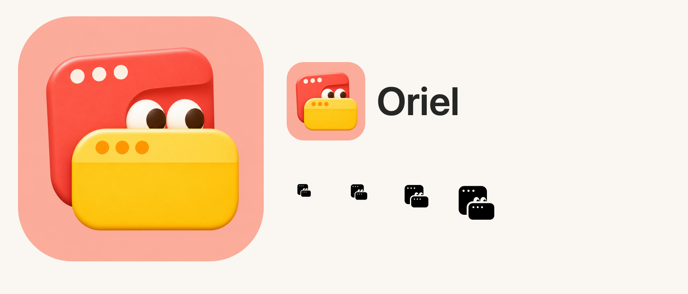

# Oriel · 05A Curious

用户从 [Peek 变体对比图](peek-studies.png) 中选定左侧的 **05A Curious**：珊瑚红小窗从金黄色前窗后探头，两只眼睛向右看，整体为浅桃色圆角应用图标。



## 使用

- 应用图标与侧栏保留原图的色彩、眼睛、立体质感、前后叠窗和三个标题栏圆点。
- 侧栏使用 30×30 pt 彩色 PDF；该 PDF 内嵌高清位图，不是完整的矢量重绘。
- 菜单栏使用 18×18 pt 单色矢量 PDF，保留叠窗、探头眼睛与标题栏圆点，设置 `isTemplate = true`，可访问名称为 Oriel。
- 打包原图使用铺满画布的桃色方形背景，由 macOS 施加应用图标圆角与系统材质，避免重复底板。侧栏与预览使用圆角容器。

## 资源与生成

| 文件 | 用途 |
| --- | --- |
| [oriel-05a-source.png](oriel-05a-source.png) | imagegen 内置工具按选定 05A 提取并适配 macOS 打包的高清原图 |
| [oriel-05a-source.json](oriel-05a-source.json) | 原图来源、参考图及完整生成提示词 |
| [oriel-icon.png](oriel-icon.png) | 打包用 1024×1024 图标 |
| [oriel-menu.svg](oriel-menu.svg) | 单色菜单栏图形的矢量导出 |
| [Oriel.icns](../../OrielApp/Resources/Brand/Oriel.icns) | macOS 多尺寸应用图标 |
| [OrielMark.pdf](../../OrielApp/Resources/Brand/OrielMark.pdf) | 侧栏彩色资源 |
| [OrielMenuTemplate.pdf](../../OrielApp/Resources/Brand/OrielMenuTemplate.pdf) | 菜单栏矢量模板 |

从仓库根目录执行：

```sh
swift scripts/generate-brand.swift
```

脚本在 macOS 上使用 AppKit 与系统 `iconutil`，读取已保存的 05A 原图，不会再次调用图像生成服务。它输出彩色 PDF、单色 PDF/SVG、预览图及十种图标分辨率，再生成 ICNS。彩色设计以原图为准；单色几何由脚本维护。

Xcode 和本地构建脚本均打包 `OrielApp/Resources/Brand` 目录；`Config/Info.plist` 的 `CFBundleIconFile` 为 `Brand/Oriel.icns`。

## 验证

标准 Xcode 构建、严格代码签名校验与资源加载均通过；已核对 [实际主界面截图](../../.impeccable/review/logo/management-05a.png) 和系统解析的应用图标。单色小尺寸效果见上方预览；尚无真实菜单栏明暗外观切换截图，不将预览视作该项实机验收。
